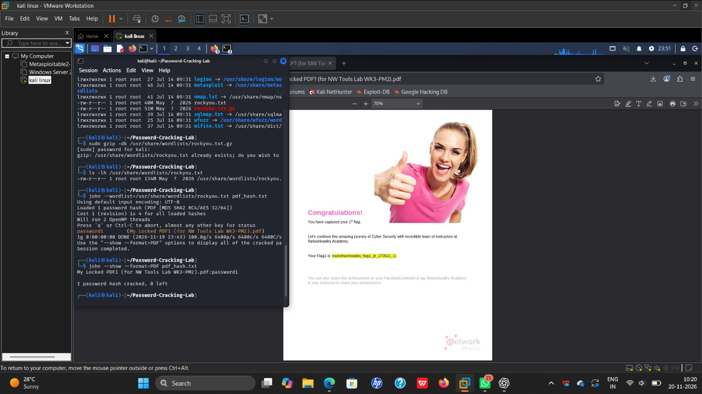
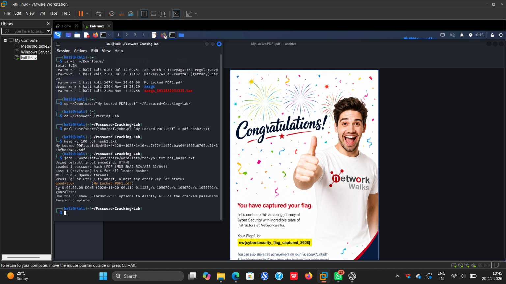
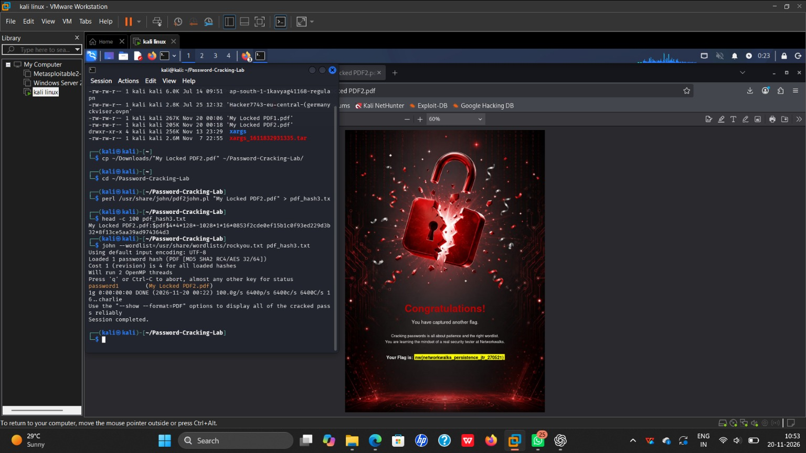
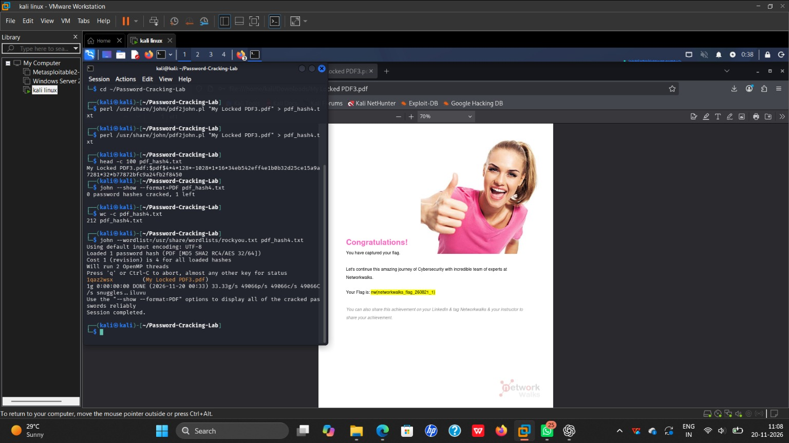

# 🔐 PDF Password Auditing & Recovery Using John the Ripper

### Hands-on Cybersecurity | Ethical Hacking | Kali Linu


## 📌 Project Overview

This project demonstrates a practical approach to auditing password-protected PDF documents using **John the Ripper** in a Kali Linux environment.

The objective was to understand how PDF password hashes can be extracted and tested against a wordlist using dictionary-based password auditing techniques.

Through this hands-on exercise, I explored password hash extraction, wordlist preparation, password recovery, and result verification.

## 🎯 Project Objectives

- Understand PDF password protection and hash extraction.
- Learn how PDF2John works.
- Install and configure John the Ripper.
- Perform dictionary-based password auditing.
- Work with the RockYou wordlist.
- Verify password recovery results.
- Understand the importance of strong password security.

## 🛠️ Tools & Technologies

| Tool | Purpose |
|---|---|
| Kali Linux | Penetration testing environment |
| John the Ripper | Password auditing and recovery |
| PDF2John | PDF password hash extraction |
| RockYou | Password wordlist |
| Linux Terminal | Command execution |

## ⚙️ Practical Implementation

### 1. Environment Setup

Installed and verified John the Ripper on Kali Linux.

```bash
john --list=build-info
```

### 2. PDF Hash Extraction

Used PDF2John to extract password hashes from the authorized lab PDF documents.

```bash
perl /usr/share/john/pdf2john.pl "sample.pdf" > pdf_hash.txt
```

### 3. Wordlist Preparation

Used the RockYou wordlist available in Kali Linux.

```bash
ls -lh /usr/share/wordlists/rockyou.txt
```

### 4. Dictionary-Based Password Auditing

Executed John the Ripper against the extracted PDF hashes.

```bash
john --wordlist=/usr/share/wordlists/rockyou.txt pdf_hash.txt
```

### 5. Result Verification

Verified recovered passwords using:

```bash
john --show --format=PDF pdf_hash.txt
```

## 🔄 Project Workflow

```text
       PDF Document
             |
             v
     PDF2John Extraction
             |
             v
       PDF Hash File
             |
             v
       RockYou Wordlist
             |
             v
      John the Ripper
             |
             v
      Password Testing
             |
             v
      Result Verification
```

## 📸 Practical Screenshots

Screenshots below document the actual practical implementation

### 1. Password Recovery – Practical 1


### 2. Password Recovery – Practical 2


### 3. Password Recovery – Practical 3


### 4. Password Recovery – Practical 4



## 📊 Practical Results

The following results were confirmed during the lab:

| Activity | Result |
|---|---|
| PDF hash extraction | Successfully performed |
| PDF password format detection | Confirmed |
| RockYou wordlist integration | Successful |
| Dictionary attack | Successfully performed |
| Password recovery | 2 confirmed recoveries |
| Result verification | Performed for recovered results |

Two additional PDF hashes were extracted; their password recovery results were not confirmed in the recorded practical.

## 📚 Key Learning Outcomes

- Gained hands-on experience with Kali Linux.
- Understood PDF password hash extraction.
- Learned to use John the Ripper for password auditing.
- Practiced dictionary-based password attacks.
- Understood the role of wordlists in password security testing.
- Learned to verify password recovery results.

## 🔐 Security Awareness

This practical highlights why weak and commonly used passwords can create security risks.

Using strong, unique passwords and avoiding predictable password patterns can improve document security.

## ⚖️ Disclaimer

This project was performed for educational purposes in an authorized lab environment.

All password auditing activities should only be performed on documents you own or have explicit permission to test.

---

### 👩‍💻 Project Category
**Cybersecurity | Ethical Hacking | Password Security | Practical Learning**
